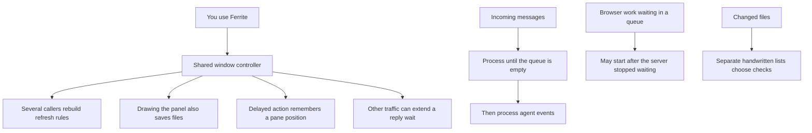
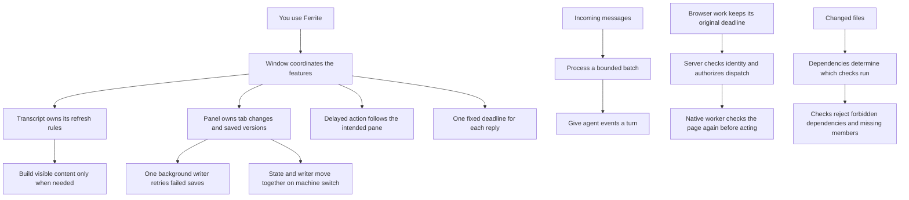

# What changed in Ferrite's architecture

The goal is to make a change in one feature less likely to break another. This document separates changes to the structure from evidence that the behavior works.

The implementation and focused verification are complete. The diagrams describe the implemented structure. The recorded tests and application checks provide the behavioral evidence. The remaining architectural work is listed at the end.

## Before

The browser sequence was a source-backed risk, not a reproduced historical incident. The unbounded reply and server-intake behavior failed dedicated regressions before their fixes.

## After

The shared window controller still exists. Its transcript refresh contract, panel mutation and persistence, delayed pane targeting, and browser request lifecycle now have more explicit owners. This pass does not replace the renderer or split the whole application into independent entities.

## What makes the changes structural

| Area | What a future contributor no longer needs to remember | What enforces the rule |
|---|---|---|
| Transcript refresh | Update three separate cache-key constructions | One presentation object is compared and retained by the transcript. The old key and update interfaces are removed. |
| Panel edits | Mark the panel dirty after mutating its tabs | Typed actions update the owned state and its persistence revision. Mutable access through `surfaces_mut` is removed. |
| Panel saving | Save during rendering and clear the dirty flag correctly | One ordered writer tracks saved versions, retries failures, and cannot mark a newer edit saved. |
| Controller replacement | Wait for an old writer before loading a new owner | The state and writer transfer together. The previous controller loses its writer. |
| Sticky prompt redraw | Treat a completed redraw request as permanently remembered | The request clears when measured and rendered positions converge, so later navigation can request it again. |
| Delayed preview | Repair a stored array position after another pane closes | The action carries the pane's identity and resolves it when it runs. A missing pane makes the action stop. |
| Server progress | Stop draining a busy client's messages eventually | A fixed intake budget returns control to session pumping. |
| Reply waits | Subtract time already spent processing unrelated messages | One absolute deadline is created outside the receive loop. |
| Browser dispatch | Coordinate timeout, restart, queue, and native execution independently | Submission deadline, boot identity, and queued/authorized phases govern a single-use dispatch grant. |
| Verification selection | Add each new dependency to several workflow path lists | A checked dependency graph selects affected packages. Untracked local members fail closed. |

## Evidence

The two progress regressions failed against the old runtime and passed after the fix. Their recorded green run is [progress-tests.log](evidence/progress-tests.log).

The verification selector has 23 passing focused Python tests. They cover dependency propagation, unknown changes, documentation-only changes, forbidden dependency edges, and unlisted local helper packages.

The integrated focused run recorded 59 passes and two incorrect UI fixture expectations in [focused-tests.log](evidence/focused-tests.log). After correcting those expectations, all three affected tests passed in [corrected-ui-tests.log](evidence/corrected-ui-tests.log). Two additional native permission tests pass in [native-permission-tests.log](evidence/native-permission-tests.log).

Visual testing found a disappearing sticky prompt even though scrolling returned to the correct content offset. A new rendered-behavior regression [failed before the fix](evidence/sticky-prompt-red.log), then passed with both transcript reconciliation checks in [sticky-prompt-green.log](evidence/sticky-prompt-green.log). There are now 64 distinct passing Rust checks.

The headless application flow passed all 17 assertions in [result.json](evidence/headless-verified/result.json). The checks preserve exact draft text across conversation switching, switch Files and Overview, restore tabs after restart, and verify that transcript pixels move on page navigation and return exactly after End. The [restored panel screenshot](evidence/headless-verified/06-restarted-tabs.png) and [final transcript screenshot](evidence/headless-verified/11-bottom-again.png) were inspected.

The final typecheck passed in [typecheck-keychain-fixture.log](evidence/typecheck-keychain-fixture.log). The packaged native browser passed all 12 boundary checks in [boundary-results.json](evidence/browser-verified/boundary-results.json). A queued write expired while native attachment was held and did not execute after release. A separate write committed before its reply timed out, remained uncertain, and was not replayed. The independent page recorded exactly one save. The [native screenshot](evidence/browser-verified/window-boundaries.png) shows the saved page, and [owned-processes.json](evidence/browser-verified/owned-processes.json) records no surviving probe processes.

This native run used the real CEF window and provider adapter with a deterministic provider fixture and explicit isolated test keychain. Initial runs stalled in OS Keychain access; production credential storage remains unverified. The probe also now handles the current panel selector, fixture version precedence, and either concurrent request arriving first. The [verification record](evidence/verification.md) retains exact commands, earlier failures and the limits of each check.

Independent review found and corrected important gaps during implementation. The selector initially missed implicit local packages. The panel writer initially lacked safe ownership transfer during a machine switch. Browser review also required the original submission deadline to cover work queued before server dispatch.

## Principles that changed the implementation

These are the `/pstack-poteto-mode` principles applied to concrete decisions in this pass.

| Principle | Decision it changed |
|---|---|
| [Boundary Discipline](/Users/josephwylie/.codex/pstack/skills/principle-boundary-discipline/SKILL.md) | Give panel persistence and native dispatch explicit owners, then reject dependency edges that reverse the intended layers. |
| [Model the Domain](/Users/josephwylie/.codex/pstack/skills/principle-model-the-domain/SKILL.md) | Represent browser work as queued or authorized, and use pane identity rather than a shifting array position. |
| [Subtract Before You Add](/Users/josephwylie/.codex/pstack/skills/principle-subtract-before-you-add/SKILL.md) | Replace duplicated refresh keys and dirty flags with the owning state, rather than adding another coordination layer. |
| [Migrate Callers, Then Delete Legacy APIs](/Users/josephwylie/.codex/pstack/skills/principle-migrate-callers-then-delete-legacy-apis/SKILL.md) | Move all transcript callers to reconciliation and remove the old key, match, and sync entry points. |
| [Laziness Protocol](/Users/josephwylie/.codex/pstack/skills/principle-laziness-protocol/SKILL.md) | Borrow the presentation metadata and build expensive transcript content only when it changes. |
| [Encode Lessons in Structure](/Users/josephwylie/.codex/pstack/skills/principle-encode-lessons-in-structure/SKILL.md) | Make revisions, single-use dispatch grants, and dependency checks enforce rules that agents previously had to remember. |
| [Fix Root Causes](/Users/josephwylie/.codex/pstack/skills/principle-fix-root-causes/SKILL.md) | Fix the sticky prompt redraw lifecycle after reproducing it, while retaining the original full-image assertion. |
| [Test Behavior, Not Implementation](/Users/josephwylie/.codex/pstack/skills/principle-test-behavior-not-implementation/SKILL.md) | Check rendered prompt visibility, exact sent drafts, restored tabs, and independently recorded browser writes. |
| [Prove It Works](/Users/josephwylie/.codex/pstack/skills/principle-prove-it-works/SKILL.md) | Pair the architecture claims with regressions, source review, and isolated application evidence. |

## What this does not prove

A bounded message batch cannot make an individual slow synchronous command nonblocking. A fixed reply deadline still permits waiting until that deadline. Browser work authorized before a timeout may have applied, so Ferrite must continue reporting uncertainty and must not replay the write automatically.

The broader shared window owner, duplicated operation-availability policy, and possible partial-inventory pruning remain separate design work. The checks here do not prove that every future change is safe, or that every part of the architecture is now better. They establish specific ownership improvements and behavior that can be checked again.

The [original review](review.md) records the broader findings. The [decision trail](decisions.tsv) records choices and corrections during this implementation.
