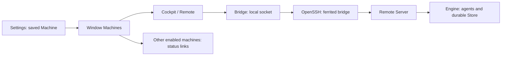

# Remote connections: how and why

Grounding at Ferrite `f7884cff`, before implementation. Synthesizes the explorer and investigator reports, with spot checks against code, ADRs, PR #286 and the historical benchmark. T3 reference: `pingdotgg/t3code@4da2bc520c38cd6b36014d2888774168fbf4c77f`. No application edits, builds or tests were performed for this document.

## How it works

Ferrite already runs agents on another machine. The missing work is assisted setup and a recoverable connection workflow in Settings. A saved `Machine` contains `name`, `target` and `enabled`; `target` is also the existing connection identity. Its `Bridge` adapts SSH stdio into the same local socket interface the Cockpit uses for the local Server. The remote Server owns the Engine, Store and agents; the window receives state and sends commands. [Machine and Bridge](https://github.com/josephwylie/ferrite/blob/f7884cff/crates/ferrite-core/src/machine.rs#L22), [ownership](https://github.com/josephwylie/ferrite/blob/f7884cff/docs/adr/0025-ferrited-server.md#L56).

**Connection flow.** `Bridge::ssh` builds a per-process local socket and an SSH dialer. Each attach invokes `ssh … -- <target> ferrited bridge`. OpenSSH uses the operator's configuration, with Ferrite's own control socket on platforms supporting multiplexing. Batch connections cannot prompt. Interactive sign-in opens SSH in a terminal; the resulting master supplies later connections. `Bridge::attach` performs the existing protocol handshake through that socket. `cockpit::Remote` attaches in the background, records failures and manages reconnection. On the other machine, `ferrited bridge` ensures its Server is running and copies bytes between stdin/stdout and the Server socket. [Bridge](https://github.com/josephwylie/ferrite/blob/f7884cff/crates/ferrite-core/src/machine.rs#L174), [Remote](https://github.com/josephwylie/ferrite/blob/f7884cff/crates/ferrite-core/src/cockpit/remote.rs#L244), [remote bridge](https://github.com/josephwylie/ferrite/blob/f7884cff/crates/ferrite-core/src/server/bridge.rs).

**Selection and ownership.** Window-local `Machines` maintains the selected machine and status-only links to other enabled machines. Switching builds a fresh `CockpitView`; each Store can reuse the same Thread IDs, so retaining the old view's per-thread caches would mix machines. Off-screen links report state and alerts without watching transcripts. Remote paths, repository operations, provider CLIs and machine defaults belong to the attached Server; local display preferences remain local. [Selection and status](https://github.com/josephwylie/ferrite/blob/f7884cff/docs/adr/0026-machines-over-ssh.md#L183), [remote paths](https://github.com/josephwylie/ferrite/blob/f7884cff/docs/adr/0026-machines-over-ssh.md#L246), [PR #286](https://github.com/josephwylie/ferrite/pull/286).

**Current Settings gap.** Machines appears under About. Add validates the target's shape and immediately saves it, then clears the input even on validation failure. All `Connection::Attention` rows offer “Sign in”, although the core distinguishes missing `ferrited` from authentication failure. This is a UI recovery mismatch, not missing remote execution. [Placement](https://github.com/josephwylie/ferrite/blob/f7884cff/docs/adr/0026-machines-over-ssh.md#L235), [current form and actions](https://github.com/josephwylie/ferrite/blob/f7884cff/crates/ferrite-cockpit/src/cockpit/machines.rs#L261), [failure types](https://github.com/josephwylie/ferrite/blob/f7884cff/crates/ferrite-core/src/machine.rs#L79).

**T3 comparison.** T3's form accepts host/alias plus optional username and port; it disables controls during addition and retains an inline error on failure. Its bootstrap chooses a platform archive for a particular version, checks SHA256, extracts into staging and proves the executable runs before marking the installation ready. The reported onboarding trace provisions and connects before persisting the environment. Ferrite can adopt the workflow without adopting T3's HTTP transport. Ferrite's release workflow currently packages macOS and Windows desktop installers, with no Linux headless release job; an installer cannot assume a downloadable `ferrited` asset already exists. [T3 form](https://github.com/pingdotgg/t3code/blob/4da2bc520c38cd6b36014d2888774168fbf4c77f/apps/web/src/components/settings/AddEnvironmentDialog.tsx#L166), [T3 bootstrap](https://github.com/pingdotgg/t3code/blob/4da2bc520c38cd6b36014d2888774168fbf4c77f/packages/ssh/src/tunnel.ts#L521), [Ferrite release workflow](https://github.com/josephwylie/ferrite/blob/f7884cff/.github/workflows/release.yml).

The implementation entry points are `ferrite-core/src/machine.rs` for SSH and failures, `cockpit/remote.rs` for attachment, `server/bridge.rs` and `server/agent.rs` (its `systemd` module) for remote lifecycle, `ferrite-cockpit/src/machines.rs` and `cockpit_window.rs` for selection, and `cockpit/machines.rs` plus `cockpit.rs` for Settings construction.

## Why it has this shape

### The question

Which existing remote architecture decisions should a T3-like Connections workflow preserve, and which current limitations reflect initial scope rather than enduring constraints?

### The code in question

Core symbols: `Machine`, `Bridge`, `Failure`, `Endpoint`, `Remote`, `Server`, `Engine`. Window symbols: `Machines`, `MachineKey`, `CockpitWindow::go_to`, `CockpitView::machine_settings`. The primary anchors are linked above.

### What we found

- **[Direct] Agents must outlive the window.** ADR 0025 names quitting/crashing the window as the old failure and puts agents in a background Server. It prescribes restarting when agents are idle rather than handing off live processes. [ADR 0025, context](https://github.com/josephwylie/ferrite/blob/f7884cff/docs/adr/0025-ferrited-server.md#L5).
- **[Direct] SSH was chosen to reach the same Server contract without storing credentials.** ADR 0026 explicitly keeps `link::Client::attach` and generation 1 unchanged, uses the operator's SSH configuration, and leaves password/MFA/host-key interaction to SSH. Authentication failures stop automatic retries to avoid repeated refused logins. [ADR 0026, bridge and sign-in](https://github.com/josephwylie/ferrite/blob/f7884cff/docs/adr/0026-machines-over-ssh.md#L76).
- **[Direct] Rebuilding the selected Cockpit protects machine-local identity.** The ADR explicitly gives per-Store Thread ID reuse and the view's many per-thread caches as the reason. [ADR 0026, selection](https://github.com/josephwylie/ferrite/blob/f7884cff/docs/adr/0026-machines-over-ssh.md#L191).
- **[Direct] Detached process creation alone does not establish Linux persistence.** The ADR documents `KillUserProcesses=yes`, the systemd user service and the need for linger after the final logout. Installing the unit does not automatically replace an already-running detached Server, nor does uninstall stop running agents. [ADR 0026, lifecycle](https://github.com/josephwylie/ferrite/blob/f7884cff/docs/adr/0026-machines-over-ssh.md#L31).
- **[Direct] Machine settings and provider management must act on the attached machine.** PR #286 explicitly corrects local execution of these operations while retaining local window preferences. Its validation used a fake SSH shim, which the PR states as a limitation. [PR #286](https://github.com/josephwylie/ferrite/pull/286).
- **[Direct] Preinstalled `ferrited` was the initial scope.** The historical benchmark says “Start with” `ferrited` already on the remote PATH. ADR 0026 records the prerequisite and source-install command. The aggregate #128 squash includes the original SSH implementation narratives; it should not be read as one narrowly scoped SSH change. [Historical benchmark, §6](https://github.com/josephwylie/ferrite/blob/f1d5ecef261c9225119dab8056ba0ad35d343740/docs/research/herdr-benchmark-2026-10-15.md#L222), [ADR 0026](https://github.com/josephwylie/ferrite/blob/f7884cff/docs/adr/0026-machines-over-ssh.md#L19), [aggregate commit](https://github.com/josephwylie/ferrite/commit/3c2de915).

### What we can reasonably infer

- **[Inferred] Assisted installation appears compatible with the original direction.** The benchmark's “Start with” wording establishes a first increment, while the architecture already provides a headless executable and a stable attach boundary. This suggests installation can precede the existing attachment, without introducing a second agent runtime. It does not establish any historically selected installer design.
- **[Inferred] Moving Machines out of About and retaining failed input appears unconstrained by the architectural rationale.** The ADR records the placement but supplies no reason for it; the explicit invariants concern execution ownership, identity, credentials and lifecycle.

### What we don't know

No evidence located explains About placement, saving before validation against a real Server, or omission of assisted setup. The historical prerequisite is not evidence that bootstrap was rejected. The final distribution strategy, supported remote platforms, version compatibility policy and service/linger UX remain design decisions. A successful SSH command alone cannot prove protocol compatibility or survival after logout.

Long-form ChatGPT Space queries `Ferrite`, `machines SSH` and `ferrited remote` returned no items, with partial `content_failed` coverage; they do not establish that no relevant document exists. External issue, chat, observability, exception and analytics sources were unavailable. No author was contacted.

### Sources consulted

- **Source control history:** explorer/investigator traces; ADRs 0025/0026; machine/bridge/remote/window/Settings code; PR #286; aggregate #128 (`3c2de915`); the benchmark before deletion (`5261eb12^`); release workflow. This synthesis spot-checked these anchors; the total historical commits reviewed by the prior investigators was not supplied. T3 comparison used the pinned source commit above.
- **Issue / ticket tracker:** no matching MCP available; GitHub PR evidence is counted under source control, not a complete issue search.
- **Long-form documents:** repository ADRs and historical benchmark; ChatGPT Space searches listed above, no returned items and partial search failure.
- **Real-time team chat:** not searched; no matching MCP available.
- **Infrastructure observability:** not searched; no matching MCP available.
- **Error / exception tracking:** not searched; no matching MCP available.
- **Product analytics warehouse:** not searched; no matching MCP available.

### Confidence summary

High confidence in the ownership, SSH credential, identity and Linux lifecycle rationale: the ADRs state it explicitly. Initial manual installation is documented scope; why the current Settings experience stayed minimal is unknown. No production telemetry or full external discussion history was available.

## Implications for the change

These are implementation recommendations derived from the evidence, not historical decisions:

- **Preserve:** one remote Server as execution owner; the existing protocol; OpenSSH configuration and host verification; stopped authentication retries; per-machine identity isolation; local window preferences and remote machine defaults.
- **Change:** expose Connections; accept typed host/user/port input; model setup progress and recoverable failures explicitly; prepare and prove protocol attachment before saving; distinguish sign-in, installation, compatibility and reachability recovery.
- **Avoid:** shell-interpolated user targets, storing SSH credentials, local interpretation of remote paths, replacing running Servers with live agents, and treating disconnect/remove as remote agent termination.
- **Risk to resolve:** real server distribution and executable compatibility; platform differences in SSH multiplexing; service/linger persistence; cancellation and partial installations; version/identity collisions when username or port becomes explicit. Release URLs must correspond to real assets, or setup must honestly offer source installation. A native screenshot matrix and one actual remote protocol flow are still required; this grounding is not runtime verification.
