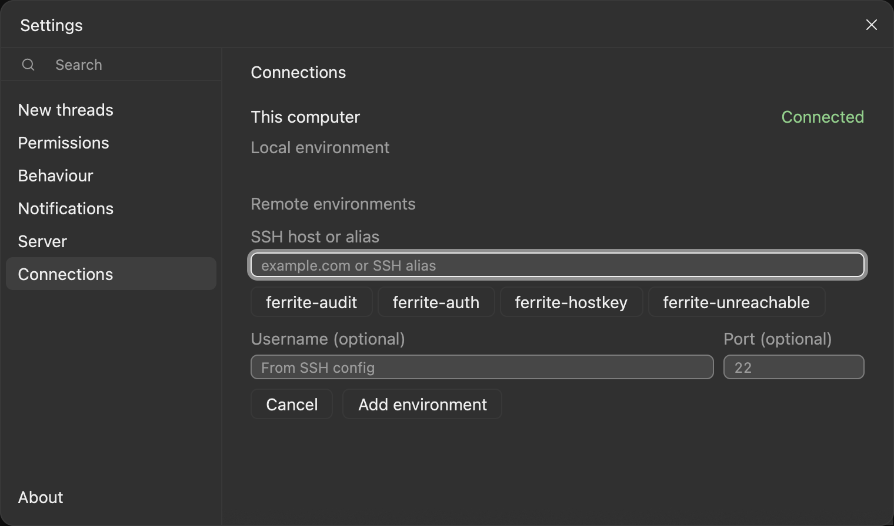
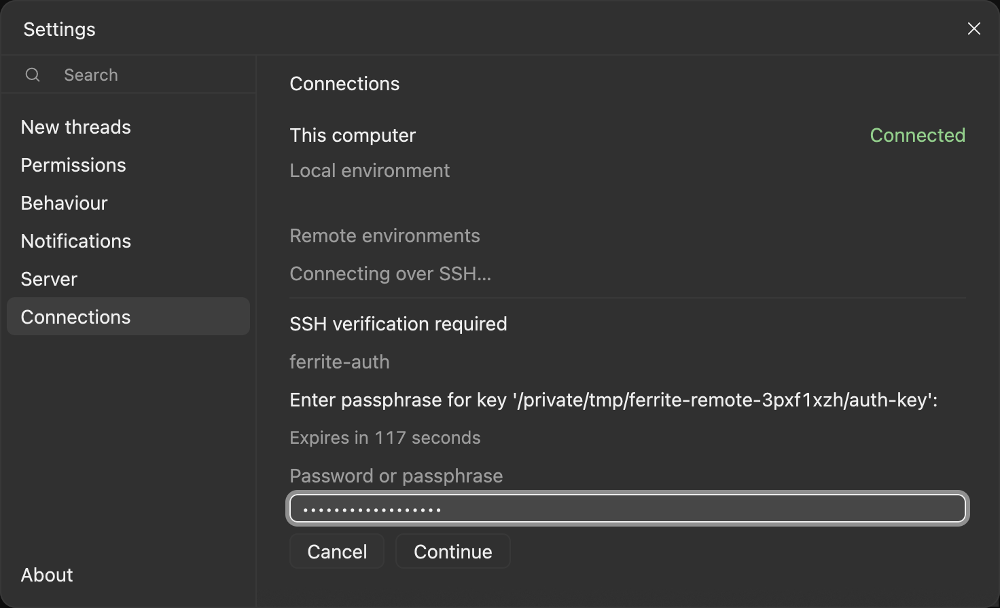
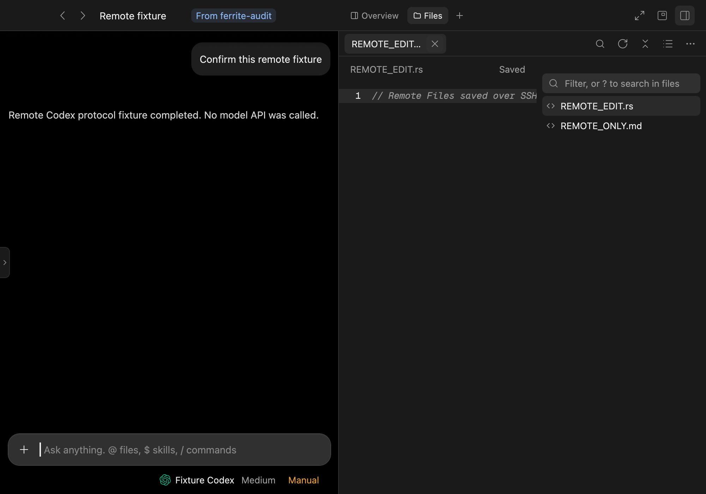
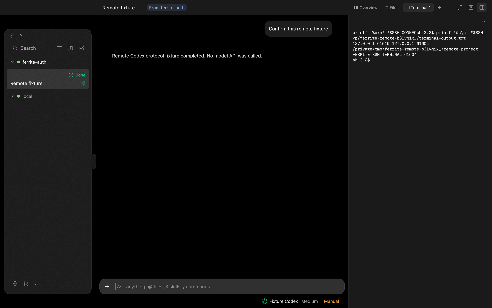

# Earlier SSH visual gallery

This is the earlier SSH-only iteration. The current connection modes and end-to-end parity evidence are in the [updated review gallery](parity/gallery.md).

69 captures from Ferrite’s production native renderer. Real localhost OpenSSH, prepared task-owned Server, and clearly labeled simulated Codex responses. The setup-warning diagnostic alone is fault-injected; file errors, conflicts, terminal exit and recovery use actual SSH operations.

Settings images are lossless crops of the modal; tool images retain the whole window. No retouching, rescaling, compositing or generated UI. The [manifest](evidence/screenshot-manifest.json) records original hashes, dimensions, crop coordinates and public-image hashes. Untrimmed captures and failed debug attempts remain local and can be regenerated with the [harness](../../../scripts/verify-remote-connections.py).

Both independent visual reviews returned **ship** after the compact text corrections. See [review findings](reviews.md) and [verification boundaries](verification.md).

## Add and authenticate

## Remote coding tools

## Every captured state

| State | 1440×900 | 1000×700 | 800×600 |
| --- | --- | --- | --- |
| Connections empty state | [View](evidence/screenshots/1440x900/01-connections-empty-1440x900.png) | [View](evidence/screenshots/1000x700/01-connections-empty-1000x700.png) | [View](evidence/screenshots/800x600/01-connections-empty-800x600.png) |
| Add environment | [View](evidence/screenshots/1440x900/02-add-form-1440x900.png) | [View](evidence/screenshots/1000x700/02-add-form-1000x700.png) | [View](evidence/screenshots/800x600/02-add-form-800x600.png) |
| Invalid port and retained input | [View](evidence/screenshots/1440x900/03-invalid-input-retained-1440x900.png) | [View](evidence/screenshots/1000x700/03-invalid-input-retained-1000x700.png) | [View](evidence/screenshots/800x600/03-invalid-input-retained-800x600.png) |
| Host-key confirmation | [View](evidence/screenshots/1440x900/03b-host-key-confirmation-1440x900.png) | [View](evidence/screenshots/1000x700/03b-host-key-confirmation-1000x700.png) | [View](evidence/screenshots/800x600/03b-host-key-confirmation-800x600.png) |
| Connecting and cancellation | [View](evidence/screenshots/1440x900/04-connecting-1440x900.png) | [View](evidence/screenshots/1000x700/04-connecting-1000x700.png) | [View](evidence/screenshots/800x600/04-connecting-800x600.png) |
| Connection failure | [View](evidence/screenshots/1440x900/05-connection-failure-1440x900.png) | [View](evidence/screenshots/1000x700/05-connection-failure-1000x700.png) | [View](evidence/screenshots/800x600/05-connection-failure-800x600.png) |
| Native passphrase prompt | [View](evidence/screenshots/1440x900/06-native-auth-prompt-1440x900.png) | [View](evidence/screenshots/1000x700/06-native-auth-prompt-1000x700.png) | [View](evidence/screenshots/800x600/06-native-auth-prompt-800x600.png) |
| Filled masked response | — | — | [View](evidence/screenshots/800x600/06b-masked-auth-response-800x600.png) |
| Connected environment | [View](evidence/screenshots/1440x900/07-connected-row-1440x900.png) | [View](evidence/screenshots/1000x700/07-connected-row-1000x700.png) | [View](evidence/screenshots/800x600/07-connected-row-800x600.png) |
| Disconnected environment | [View](evidence/screenshots/1440x900/08-disabled-row-1440x900.png) | [View](evidence/screenshots/1000x700/08-disabled-row-1000x700.png) | [View](evidence/screenshots/800x600/08-disabled-row-800x600.png) |
| Reconnected environment | [View](evidence/screenshots/1440x900/08b-reconnected-1440x900.png) | [View](evidence/screenshots/1000x700/08b-reconnected-1000x700.png) | [View](evidence/screenshots/800x600/08b-reconnected-800x600.png) |
| Remote machine selected | [View](evidence/screenshots/1440x900/09-remote-selected-1440x900.png) | [View](evidence/screenshots/1000x700/09-remote-selected-1000x700.png) | [View](evidence/screenshots/800x600/09-remote-selected-800x600.png) |
| Remote fixture thread | [View](evidence/screenshots/1440x900/09b-remote-thread-1440x900.png) | [View](evidence/screenshots/1000x700/09b-remote-thread-1000x700.png) | [View](evidence/screenshots/800x600/09b-remote-thread-800x600.png) |
| Compact empty editor | — | — | [View](evidence/screenshots/800x600/09c-empty-editor-800x600.png) |
| Remote Files tree | [View](evidence/screenshots/1440x900/09c-remote-files-tree-1440x900.png) | [View](evidence/screenshots/1000x700/09c-remote-files-tree-1000x700.png) | [View](evidence/screenshots/800x600/09c-remote-files-tree-800x600.png) |
| Remote source read | [View](evidence/screenshots/1440x900/09d-remote-file-read-1440x900.png) | [View](evidence/screenshots/1000x700/09d-remote-file-read-1000x700.png) | [View](evidence/screenshots/800x600/09d-remote-file-read-800x600.png) |
| Remote source saved | [View](evidence/screenshots/1440x900/09e-remote-file-saved-1440x900.png) | [View](evidence/screenshots/1000x700/09e-remote-file-saved-1000x700.png) | [View](evidence/screenshots/800x600/09e-remote-file-saved-800x600.png) |
| Remote SSH terminal output | [View](evidence/screenshots/1440x900/09f-remote-terminal-output-1440x900.png) | [View](evidence/screenshots/1000x700/09f-remote-terminal-output-1000x700.png) | [View](evidence/screenshots/800x600/09f-remote-terminal-output-800x600.png) |
| Connections from remote workspace | [View](evidence/screenshots/1440x900/10-remote-connections-1440x900.png) | [View](evidence/screenshots/1000x700/10-remote-connections-1000x700.png) | [View](evidence/screenshots/800x600/10-remote-connections-800x600.png) |
| Remove confirmation | [View](evidence/screenshots/1440x900/11-remove-confirmation-1440x900.png) | [View](evidence/screenshots/1000x700/11-remove-confirmation-1000x700.png) | [View](evidence/screenshots/800x600/11-remove-confirmation-800x600.png) |
| Removed environment | [View](evidence/screenshots/1440x900/12-removed-1440x900.png) | [View](evidence/screenshots/1000x700/12-removed-1000x700.png) | [View](evidence/screenshots/800x600/12-removed-800x600.png) |
| Setup warning | — | [View](evidence/screenshots/1000x700/13-setup-warning-1000x700.png) | — |
| Remote binary guidance | — | [View](evidence/screenshots/1000x700/14-remote-binary-guidance-1000x700.png) | — |
| Remote image guidance | — | [View](evidence/screenshots/1000x700/15-remote-image-guidance-1000x700.png) | — |
| Remote file read failure | — | [View](evidence/screenshots/1000x700/16-remote-file-read-failure-1000x700.png) | — |
| Remote file retry recovered | — | [View](evidence/screenshots/1000x700/17-remote-file-retry-recovered-1000x700.png) | — |
| Remote save conflict | — | [View](evidence/screenshots/1000x700/18-remote-save-conflict-1000x700.png) | — |
| Remote conflict reloaded | — | [View](evidence/screenshots/1000x700/19-remote-conflict-reloaded-1000x700.png) | — |
| Remote conflict overwritten | — | [View](evidence/screenshots/1000x700/20-remote-conflict-overwritten-1000x700.png) | — |
| Remote terminal failed | — | [View](evidence/screenshots/1000x700/21-remote-terminal-failed-1000x700.png) | — |
| Remote terminal retry recovered | — | [View](evidence/screenshots/1000x700/22-remote-terminal-retry-recovered-1000x700.png) | — |

The full matrix establishes setup and lifecycle behavior. Later Files recaptures prove the compact correction, and the 1000×700 recovery pass covers warning, binary/image guidance, read Retry, conflict Reload/Overwrite, and terminal exit/Retry. Separate binary hashes are retained in [summary.json](evidence/native-final/summary.json).
