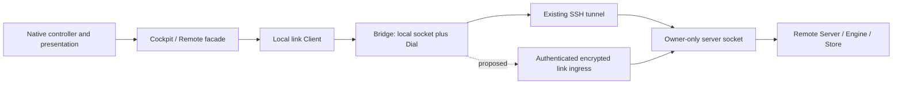

# How Ferrite can match T3's remote workflow

## Overview

The requested parity covers the complete remote workflow: environment management, both SSH and Remote link onboarding, remote attachments, Changes/PR Code, and a usable terminal. Ferrite already has a remote execution boundary, but its current connection form only represents SSH, local attachments cannot reach a remote machine, and the newer Changes panels run git on the desktop. Matching the Add dialog alone would leave those functional gaps intact.

This explanation synthesizes read-only findings for Ferrite `7eaf7f8db9f9c313189259e799be7322589aa1f0` and T3 source `4da2bc520c38cd6b36014d2888774168fbf4c77f`. Actual visual baselines come from installed T3 `0.1.10-nightly.20261111.4544`, under `docs/audits/2026-11-16-remote-connections/parity/t3`; that app is older than the source reference. Proposed integration seams below are recommendations, not existing implementation or runtime proof.

## Key Concepts

- **Server ownership:** remote paths, agent execution, retained attachment bytes, and git operations belong to the remote Server/Engine/Store. Cockpit routes requests; native presentation must not open a remote path on the desktop.
- **Native UI ownership:** `ferrite-cockpit` owns connection state and actions, `ferrite-ui` exposes typed presentation, and `ferrite-frame` draws it. Transport/setup code should not own modal geometry or focus state.
- **Machine versus environment:** Ferrite saves `Machine { name, target, enabled }` and identifies/reconciles it by SSH target. T3 gives an environment a stable identity and attaches SSH or authenticated-link routes to it. Adding a second route is not creating a duplicate environment.
- **Bridge:** `Bridge::new(name, socket, Dial)` adapts a duplex `Tunnel` to a process-owned local socket. `link::Client::attach` continues to use that socket. This is an existing transport seam, not an existing network-authentication service.
- **Attachment identity:** `DraftFiles` preserves local-source identity separately from workspace paths. A local preview source and a remote durable attachment reference serve different purposes and must remain distinguishable.
- **Two review paths:** the older Review-beside view already uses the Cockpit/Remote protocol facade; the shared Changes/PR Code implementation currently bypasses it.

## How It Works

### Environments and onboarding

T3's `/settings/connections` environment view begins with “This app” and a local-environment switch, then an “Environments” header with Add. Empty state and compact saved rows replace Ferrite's current “This computer / Connected” row and inline SSH Add form. Saved rows expose transport/status, routes, permissions, enable control, and overflow actions. Remove deletes local registration; it does not stop remote agents. Hosting/access settings are a separate view.

Add opens a centered modal with Remote link initially selected and SSH available on desktop. Remote link accepts Host plus Pairing code; a full pairing URL fills both. It resolves the endpoint, obtains the server descriptor, checks any expected environment identity before consuming the one-time credential, establishes an authenticated session, and registers environment/profile/credential. SSH provisioning ultimately converges on that same authenticated environment model. Ferrite currently follows `edit_connection` → `Machine::from_ssh_fields` → `setup::Attempt` → `save_connections`; it has no equivalent pairing path.

SSH selection refreshes discovered hosts while preserving cached results. Its editable autocomplete ranks prefix matches first, preserves username/port/source metadata, supports keyboard selection and Cmd+1…9, and permits arbitrary typed hosts. Selecting a result resolves it and immediately connects; Ferrite currently shows at most four string chips and only fills Host before focusing Username. An initial pending query, no matches, and no discoveries are distinct states. IME composition must not submit; Escape first dismisses an open popup. The existing generic native Combobox has an internal search field and is not a drop-in editable-host autocomplete.

During connection, fields/cards/submit disable and the button reads “Adding…”, while close/Escape remain available. Closing resets the next opening to Remote link; session generations discard late discovery/resolution. SSH password/code challenges appear in a separate globally queued modal with expiry. Ferrite can preserve `setup::Attempt`'s real challenge behavior while changing its presentation. `save_connections` must retain unreadable-settings and unsaved-file guards, and selected-machine environment-settings RPC must continue working.

The native controller should retain mode, inputs, popup selection, busy state, and request generation; typed presentation carries these to a dedicated renderer. Existing active-dialog APIs provide close/focus behavior, but stock dialog styling differs from T3. Settings uses deferred priority 3 and existing floating UI priority 4: the new modal and autocomplete need intentional ordering and backdrop consumption so Settings neither steals focus nor closes with its child.

Source desktop geometry provides concrete targets: settings max-width 896 px; Add modal max-width 768 px, max-height 80dvh, 16 px radius and 24 px side padding; two 96 px minimum-height mode cards separated by 12 px; 30 px input elements; 32 px full-width outline submit. Remote fields use Host + 160 px code; SSH uses full-width Host then Username + 112 px Port. The host popup starts 4 px below its anchor and has 32 px rows, up to 288 px list height. The ordinary Add modal closes through X/backdrop/Escape, with no inline Cancel. Colors/glass follow appearance settings; copying the older installed theme without recording those settings cannot establish exact parity.

### Authenticated Remote link and terminal

Today OS peer identity protects the local server socket and SSH authenticates remote transport. Protocol Hello contains no network credential. A new link dialer can reuse Bridge, but authenticated encrypted ingress must validate identity before forwarding execution messages to the owner-only socket. Pairing issuance/expiry/one-time consumption, durable server identity, secure session storage, reconnect, and route-aware persistence are new work. Legacy `{name,target,enabled}` settings must keep loading. Pairing credentials must not become display targets, logs, or child arguments; successful onboarding should prove protocol attachment before saving, as SSH setup does.

A link-backed Bridge can carry existing agent, file, and review operations. It cannot currently provide Terminal: remote terminal startup launches a local `ssh` PTY through `Bridge::terminal_args`, which rejects bridges without SSH metadata. No terminal/PTY operations were found in the protocol or Cockpit facade. Full non-SSH terminal parity requires explicit remote PTY start/input/resize/output/close support and terminal-view stream integration, or a separately available SSH route. Certificate provisioning, credential storage, and cross-platform PTY design remain unresolved.

### Attachments

Picker/drop/paste calls `Composer::add_local_files`; workspace selection calls `add_files`. `aim_attachments` sets a remote destination for machine windows, and attachment inspection immediately rejects Remote + Local as `NotOnMachine`. Workspace references are accepted without desktop I/O. Both normal submit and new-thread bootstrap pass through `admit_files`; blocked input preserves the draft. Remote retention currently does nothing because paths are assumed already on that machine. Prompts serialize trailing `@"/absolute/path"` text that providers resolve on the Server.

Removing the rejection would send desktop paths to a different computer. The proposed seam is an explicit Server-owned transfer operation reached through Cockpit/Remote: validate bounded named bytes, retain them remotely, and return a durable remote path. Keep local bytes for previews until upload succeeds, then admit the still-current composer/machine reference. Uploading, progress, failed/retry, removal, cancellation, and stale completions need shared state for existing-thread and bootstrap sends; never block GPUI awaiting a receiver. T3 begins transfers on attachment edits and binds ready uploads to environment identity.

Existing `FileOperation::Write` only writes UTF-8 text up to 2 MiB to an existing canonicalized workspace path; it cannot serve binary attachment storage. Core `retain_bytes` provides content storage but not hostile-name validation, upload limits, or concurrent scratch-file safety. The 64 MiB protocol-line limit cannot carry a 64 MiB file as one base64 message; chunking or an authenticated byte stream is necessary to preserve that retained-file ceiling. Directory behavior, cleanup, upload limits, and preview/history restoration need decisions. Provider behavior for every binary type was not fully inspected.

### Changes and PR Code

Both panels call the shared `read_changes`, obtain the selected thread's potentially remote root, then currently run local branch listing, `git diff --cached`, and `review_against`. Stage/unstage also runs local git. Existing generation checks protect presentation from stale reads, but cannot fix execution on the wrong machine. The older Review-beside path demonstrates the proper route: Cockpit → Remote → protocol ReviewRead → Server `read_off_pump` → review core → async landing.

The proposed fix moves complete reads and stage actions behind a core operation facade shared by local and remote. A cohesive ChangesRead payload could carry file sides, branch names, staged paths, and per-call base, with a corresponding stage operation; alternatively extend existing review operations deliberately. Reuse `WireReviewFile`, `ferrite-reviewr` git logic, panel rendering, folds, filters, and review marks. Existing wire review files lack staged-state metadata. Preserve generation checks and Bridge identity checks, and report connection loss without local fallback.

A panel's comparison base is per-call. Calling global `PickBase` first would mutate persisted worktree selection and interfere with other views. New optional fields need defaults and old protocol fixtures must remain valid, but an old Server silently ignoring a base would return the wrong diff: use a new explicit operation or capability negotiation. Verification needs a Server-only path and actual remote index assertions so coincidentally matching local paths cannot pass.

## Where Things Live

| Concern | Entry points |
|---|---|
| Connection controller / presentation / drawing | `crates/ferrite-cockpit/src/cockpit/connections.rs`; `crates/ferrite-ui/src/frame/settings.rs`; `crates/ferrite-frame/src/settings/connections.rs` |
| Bridge, persistence, local trust, dispatch | `crates/ferrite-core/src/machine.rs`, `link.rs`, `link/unix.rs`, `server.rs`, `server/bridge.rs` |
| Core remote facade and wire schema | `crates/ferrite-core/src/cockpit.rs`, `cockpit/remote.rs`, `protocol.rs`, `protocol/review.rs` |
| Attachment state and admission | `crates/ferrite-core/src/attachment.rs`, `prompt_files.rs`; `crates/ferrite-pane/src/draft_files.rs`, `composer.rs`, `attachments.rs`; cockpit `cockpit/attachments.rs` |
| Changes and established remote landing | cockpit `cockpit/tools/changes.rs`, `cockpit/beside.rs`, `cockpit/tools/remote_files.rs`; `crates/ferrite-reviewr/src/ferrite.rs` |
| Terminal | `crates/ferrite-cockpit/src/cockpit/tools/terminal.rs`; `Bridge::terminal_args` |
| T3 behavioral reference | `/tmp/ferrite-t3-reference/apps/web/src/components/settings/{ConnectionsSettings,AddEnvironmentDialog,SavedEnvironmentRows}.tsx`; `components/desktop/SshPasswordPromptDialog.tsx`; `packages/client-runtime/src/connection/onboarding.ts` |

## Gotchas

- Installed T3 screenshots are genuine integrated-app evidence, but are not renders of the pinned source. Source clears errors on mode change; the older installed app differs. Record version, theme, zoom, viewport, scale, and crop; one existing Ferrite “1000x700” image is actually a 1520x896 settings crop.
- No pinned-source harness was executed. Dependencies and `vp` are absent. Existing `AddEnvironmentDialog.browser.test.tsx` can provide real-component captures with production CSS; `apps/web/test/appScenarios.renders.tsx` mounts the real app/router/CSS with a fake connection driver for broader transcript evidence. A hand-copied HTML mockup is not baseline evidence.
- Stable environment identity and multiple routes require a deliberate model; target-string deduplication cannot provide T3 semantics. Routes, permissions, diagnosis, local disable/restart, discovery, linked environments, and load balancing are real reference features whose inclusion must be explicit. Do not claim them from lookalike controls.
- Remote workspace paths must remain readable only by their owner. Never infer origin from matching path prefixes. Preserve local thumbnail/history sources separately from remote references.
- This synthesis changes no repository files and runs no tests. Implementation verification should use narrow affected `cargo nextest run -p <crate>` filters once green after the last edit, one applicable `cargo check`, and one native user-flow E2E with recorded visual baselines before handback.
